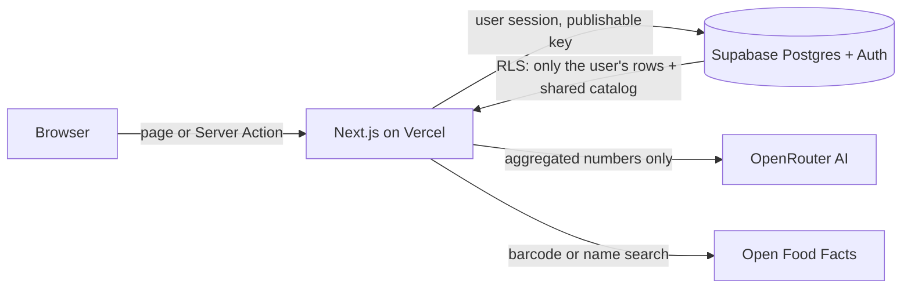

# Architecture

How the code is organized, how a request flows, and what keeps the data safe.

## Folder layout

The code follows a **screaming architecture**: top-level folders are named after what the app does (foods, diary, progress), not after technical layers.

```text
src/
├─ app/                 Thin routes only: (auth)/login, (app)/{today,diary,activity,foods,progress,insights,settings}, api/
├─ features/<name>/     One folder per feature: activity, auth, diary, foods, insights, progress, recipes, settings, shell, today
│  ├─ components/       Presentational components (props in, JSX out)
│  ├─ containers/       Client wiring: state, hooks, calls to Server Actions
│  ├─ actions/          Server Actions (mutations)
│  ├─ data/             Server-only reads
│  ├─ lib/              Feature logic: schemas, mappers, types
│  └─ strings.ts        Every UI string of the feature (Spanish)
├─ components/ui/       Shared atoms: Button, TextField, Card, Sheet, Dialog, Select, DatePicker…
├─ domain/              Pure calculators: BMR, TDEE and targets, exercise kcal, daily balance, macros
├─ lib/supabase/        Server and proxy Supabase clients
└─ proxy.ts             Session refresh + optimistic auth redirect
supabase/
├─ migrations/          Schema, RLS policies, RPCs (applied in order)
├─ tests/database/      pgTAP tests
├─ data/                Food catalogs (CSV)
└─ seed.sql             MET activity catalog
scripts/                Operator scripts: local stack, owner account, catalog extract/import
e2e/                    Playwright specs
```

## Patterns

| Pattern | Rule |
|---------|------|
| Container / presentational | Containers own state and side effects; components only render props, so they're tested in isolation. |
| Server-first data | Pages read through `data/` on the server; mutations go through Server Actions in `actions/`. |
| Pure domain | `src/domain` has no React or Supabase imports, so the nutrition math is unit-tested directly. |
| Copy in one place | UI text lives in each feature's `strings.ts`, never inline. |

## Request flow



- **The browser never talks to Supabase directly.** Every query runs on the server with the user's session and the publishable key, so Row Level Security decides what each query can see.
- **`proxy.ts` refreshes the session** on each request and redirects signed-out users to the login page early. The real check still happens on the server, in every page and action.

## Security model

| Layer | Protection |
|-------|------------|
| Accounts | Sign-ups are disabled; the only account is created with the Auth admin API. |
| Two-factor | Optional TOTP. When it's enabled, data requires an `aal2` session (enforced in RLS). |
| Sign-in | Sign-in attempts are throttled in the database: 10 per client every 15 minutes. |
| Data access | RLS on every table: users see only their own rows plus the shared food catalog, which only the service key can write. |
| Abuse limits | Row quotas per user, a daily AI generation limit, and an Open Food Facts request throttle. |
| Secrets | The service key and the OpenRouter key are server-only. Nothing secret uses the `NEXT_PUBLIC_` prefix. |
| HTTP | Content Security Policy, HSTS and anti-framing headers on every response (see `next.config.ts`). |
| Local dev | The Supabase stack and the dev server listen on 127.0.0.1 only. |

Each of these rules has tests: pgTAP files in `supabase/tests/database/` (for example `mfa_aal2`, `sign_in_throttle`, `row_quotas`, `catalog_rls`) and `e2e/security-headers.spec.ts`.

## Database changes

1. Add a new file in `supabase/migrations/`. Never edit a migration that already ran in production.
2. Cover the new rule with a pgTAP test in `supabase/tests/database/`.
3. Run `npx supabase db reset` and `npx supabase test db` locally.
4. Apply it in production as described in [Deployment](deployment.md).
